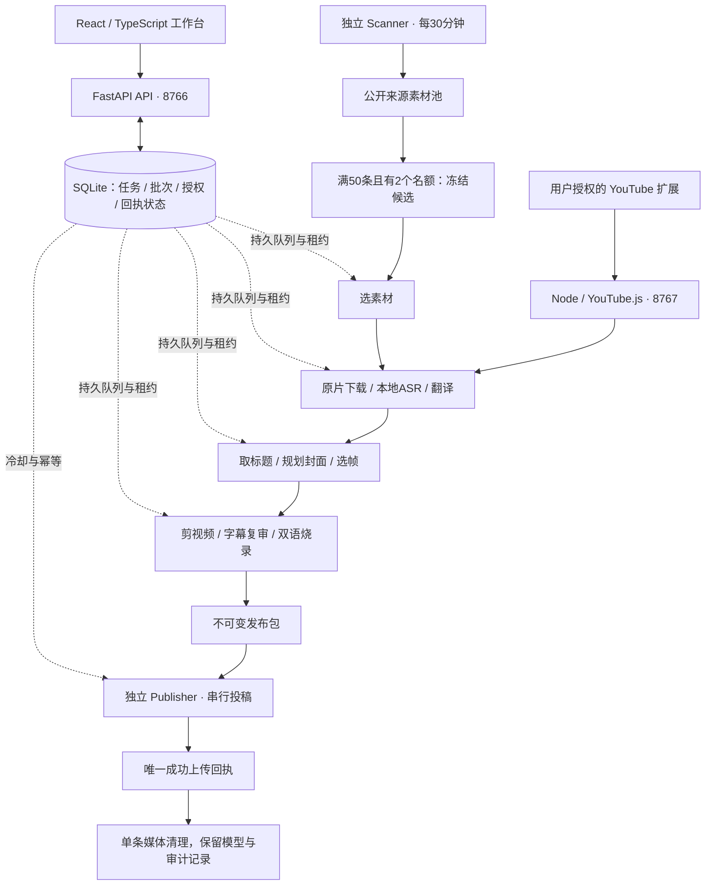
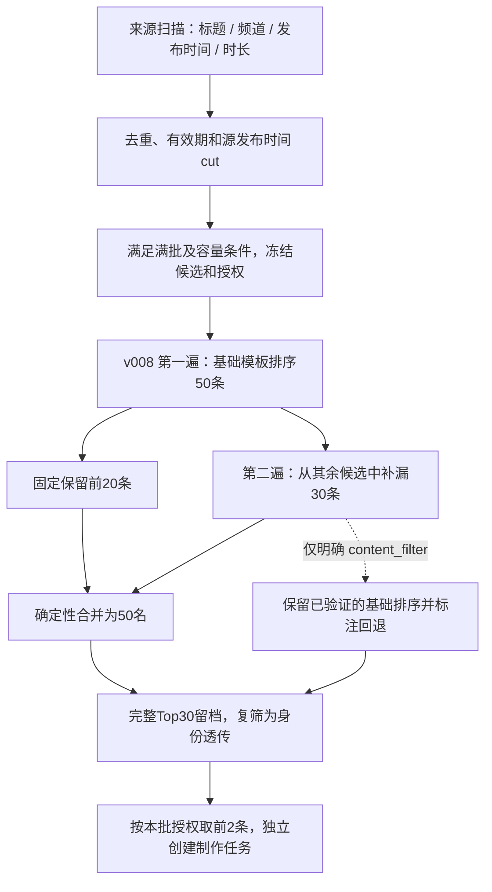
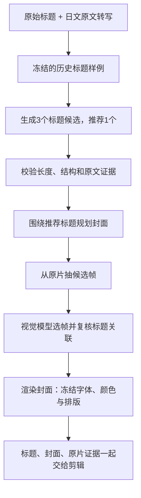
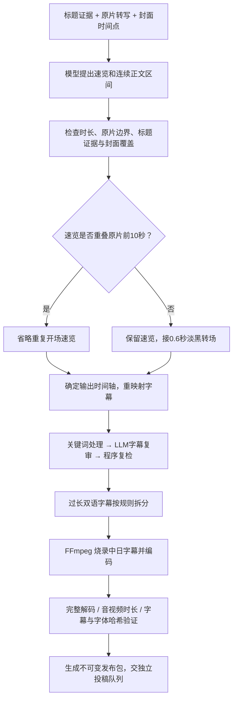

# Cyber Humorous JP

一套面向日语视频的本地内容工作台：**选素材 → 取标题与封面 → 剪视频与双语字幕 → 串行投稿**。

这是正在使用的 `workflow` 主线源码。它把扫描、制作和投稿拆成独立队列与消费者，保存模型输入输出、执行账本和上传回执，而不是一个遇错就从头重跑的脚本。

> 本仓库不包含 Cookie、API key、运行数据库、下载媒体或私人运维记录。真实模型调用可能计费，转载/公开发布需要使用者确认权利和执行授权。完整运行还依赖部分仓库外的冻结研究资料，详见 [部署说明](docs/SETUP.md)。

## 总体架构



- **前端**：React、TypeScript、Vite；查看来源、批次、队列、投稿和模型用量。
- **后端**：Python、FastAPI、SQLAlchemy、SQLite；事务领取任务、租约校验、阶段隔离。
- **制作**：一个 Worker 中四组消费者，共享模型、下载、ASR 和渲染资源上限。
- **集成**：yt-dlp、faster-whisper、FFmpeg、模型接口和外部投稿 CLI。
- **授权**：YouTube 专用扩展 + 本机加密会话；投稿权限与发布包摘要绑定。

当前运行策略为 **50 条候选选 2 条制作**、最多 **50 个在制/待投名额**；投稿结束后至少间隔 **30 分 30 秒**。这些是部署策略，不代表所有版本的默认值，首次配置应显式核对。

## 1. 选素材：先排序，再补漏

输入是配置来源的新视频元数据。扫描与制作互相独立，素材不足一批时不调用选题模型。



重要边界：

- 不把标题层面的选题假设当作已核实事实；原片证据在后续本地转写中取得。
- 历史样例按训练分区、时间边界及当前来源排除规则读取。
- 候选清单、提示词、模型设置和结果均留哈希/账本；不靠重启清零调用次数。
- 一批选题失败只隔离这一批，不自动重选原候选，也不阻塞其他独立批次。
- 原研究用“每天”描述的模板，在主线中由数量触发的批次调用，不是每日固定时刻运行。

代码入口：[选题配置与历史](backend/src/youmo_workflow/adapters/selection_profile.py)、[v008 补漏配置](backend/src/youmo_workflow/adapters/rescue_profile.py)、[批次准入](backend/src/youmo_workflow/features/batch_trigger.py)、[逐条分发](backend/src/youmo_workflow/orchestration/batch_dispatch.py)。

## 2. 取标题：基于原文证据，标题与封面绑定

先获取原片，用本地 ASR 生成带时间戳的日文转写；翻译、标题和封面都有独立的输入与结果记录。



- 当前标题方案使用冻结的 **1,195 条历史标题样例**；不把待生成标题、人工总结的钩子或选题分数偷偷塞进标题输入。
- 标题与封面计划必须保留关联证据，不能只凭视觉效果编造事实。
- 模型主通道可配置为本地 WorkBuddy 或官方接口；现有备用规则仅针对封面规划/选帧首次明确内容筛选的一次 DeepSeek 备用调用，**不是任意失败都换通道重发**。
- 格式纠正、网络重试和内容拒绝是不同情况；原请求与错误始终保留。

代码入口：[内容准备](backend/src/youmo_workflow/adapters/content_preparation.py)、[标题/封面制作](backend/src/youmo_workflow/adapters/packaging.py)、[冻结模板读取](backend/src/youmo_workflow/adapters/production_profile.py)、[模型路由](backend/src/youmo_workflow/adapters/model_route.py)。

## 3. 剪视频：模型给区间，程序负责时间轴和渲染

模型不直接操作剪辑软件，只提出原片时间区间；程序验证、重排字幕并调用 FFmpeg。



- ASR 使用逐词时间戳确定句首句尾，减少字幕提前出现或滞留。
- 字幕拆分保留文字、遮罩和原有外边界；比例分配不是逐词对齐的替代。
- 新稿使用双语硬字幕；完成后保留字幕、剪辑计划、模型记录与渲染证明。
- 投稿只以唯一成功回执确认“已投递”，不冒充审核通过或已公开。
- `unknown` 不重投，失败/取消不当作成功；成功稿才进入相应媒体清理流程。

代码入口：[剪辑编排](backend/src/youmo_workflow/adapters/editing.py)、[字幕映射与渲染](backend/src/youmo_workflow/adapters/editing_render.py)、[硬字幕](backend/src/youmo_workflow/adapters/hard_subtitles.py)、[独立投稿](backend/src/youmo_workflow/publisher_worker.py)。

## 目录

```text
backend/       Python API、业务逻辑、适配器、迁移与测试
frontend/      React 工作台
services/      YouTube.js 与本机授权服务
extensions/    YouTube 专用浏览器扩展
packages/      共享协议与生成的 API 类型
config/        公开来源元数据、规则与冻结模板
contracts/     OpenAPI 契约
e2e/           隔离浏览器测试
tooling/       质量检查、运维安装及验证工具
docs/          对外架构与部署说明
```

## 使用与验证

参见 [部署说明](docs/SETUP.md)；先准备 Python 3.13、uv、Node、pnpm 和 FFmpeg，再安装依赖：

```powershell
uv sync --project backend --frozen
pnpm install --frozen-lockfile
pnpm build
```

全量工程检查：

```powershell
pnpm exec playwright install chromium
pwsh -NoProfile -File tooling/check.ps1
```

**仅克隆本仓库还不能直接复现完整生产**：v008 的冻结研究资料、部分历史模板、本地 ASR 模型权重和投稿 CLI 未随代码分发。详细缺项及配置边界见 [SETUP](docs/SETUP.md)，不要通过删掉校验或复制别人的 Cookie 来启动。

## 安全与设计边界

- [详细架构](docs/architecture.md)：进程、队列、分层、容量、依赖暂停及重试。
- [安全说明](SECURITY.md)：凭据存储、禁止上传的文件、日志与泄露处置。
- 原片下载仅对明确 TLS EOF 做两次有上限的退避重试；不会给投稿 unknown 加盲重投。
- 私有凭据、数据库、媒体、运行日志和内部维护历史都在 Git 排除范围内。
- 部署脚本提供 NSSM 和普通后台方式，但实际自启动取决于正确配置服务账号，不能仅凭脚本存在就视作已启用。
